

These settings allow you to customize the look and feel of the IDE's tree views, including spacing, fonts, and indicators.

:::caution
Some features are only available for premium users. You can either buy a premium license for the plugin, or purchase the license for these features only by going to this link: [Material Theme Extras](https://plugins.jetbrains.com/plugin/19250-material-theme-ui-extras).
:::

----

Trees Settings are grouped into the following categories:
- [Spacing Settings](#spacing-settings)
- [Font Settings](#font-settings)
- [Indicator Settings](#indicators)
- [Arrows Settings](#arrows-style)
- [Other](#colored-open-directories)

<Figure content="/screens/settingsv3/treeSettings.png" caption="Trees Settings" />

----

## Spacing Settings

Adjust the spacing of various tree elements to improve readability or maximize screen real estate.

### Custom Tree Indent

Control the indentation of items within tree views. Whether you prefer a condensed or spacious layout, this setting helps you adjust the visual hierarchy in views like the _Project View_ and _Settings View_.

<Figure content="/screens/trees/condensedView.png" caption="Condensed Indentation" />

<Figure content="/screens/trees/expandedView.png" caption="Expanded Indentation" />

### Custom item line height

Adjust the vertical spacing between items by controlling the line height. This is particularly useful for improving readability or fitting more items on the screen at once.

<Figure content="/screens/trees/shortLineHeight.png" caption="Short Line Height" />

<Figure content="/screens/trees/largeLineHeight.png" caption="Large Line Height" />

----

### Font Settings

Customize the font family and size for tree views independently of the rest of the IDE.

<Figure content="/screens/trees/customFont1.png" caption="Custom Font and Font Size" />

<Figure content="/screens/trees/customFont2.png" caption="Custom Font and Font Size" />

----
### Indicators

Choose from several indicator styles to highlight the active item in tree views.

<Figure content="/screens/trees/indicators.png" caption="Indicators" />

Available styles:

| Style            | Screenshot                                        |
|:-----------------|:--------------------------------------------------|
| Border (default) | 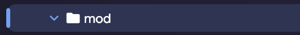    |
| Sharp Border     | 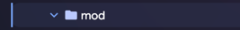     |
| Dot              | 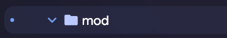       |
| Boxed            | 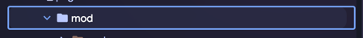     |
| Right Border     | 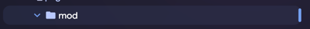     |
| Underline        | 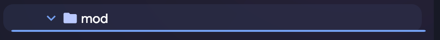 |
| None             | (no indicator)                                    |

You can also adjust the indicator thickness (from `1` to `5`).

Additionally, you can enable:
- **Use gradient**: Sets the indicator color as a gradient between the accent color and a secondary color.
- **Use complementary color**: Uses the accent color's complementary color, or a custom one of your choice.

<Figure content="/screens/trees/gradient.png" caption="Gradient Indicator" />

<Figure content="/screens/trees/thickGradientBox.png" caption="Thick Boxed Indicator with Gradient" />

Moreover, you can switch styles from the [Actions Panel](/docs/configuration/quick-actions-panel/).

----

### Arrows style

Select from a variety of arrow styles for expanding and collapsing tree nodes.

<Figure content="/screens/trees/arrows.png" caption="Arrows Styles" />

Available styles:

| Style              | Screenshot                                    |
|:-------------------|:----------------------------------------------|
| Material (default) | 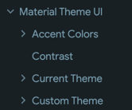  |
| Triangle           | 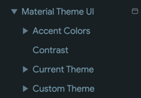  |
| Arrows             | 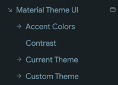    |
| Plus-Minus         | 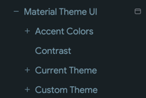 |
| Circle             | 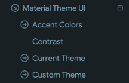    |
| None               | (no arrows)                                   |

:::caution
**Note**: If the [Atom Material Icons](https://plugins.jetbrains.com/plugin/10044-atom-material-icons) plugin is installed, this setting is disabled as it is managed by the plugin itself.
:::

----
### Colored open directories

This setting applies the accent color to directories containing open files in the _Project View_, making them easier to identify.

<Figure content="/screens/trees/coloredOpen.png" caption="Colored open directories" />
